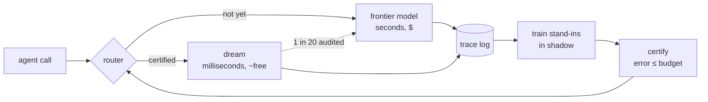

<p align="center">
  
</p>

<h1 align="center">Dreaming</h1>

<p align="center">
  <b>Your agent calls a big model on every step. Dreaming learns which calls it can stop making.</b>
</p>

<p align="center">
  
  
  <a href="https://dreaming-demo.fly.dev"></a>
  <a href="https://github.com/aidenhongg/psi"></a>
</p>

<p align="center">
  <a href="https://dreaming-demo.fly.dev">Live demo</a> ·
  <a href="https://dreaming-demo.fly.dev/launch/">Judges' deck</a> ·
  <a href="https://github.com/aidenhongg/psi">Psi</a> ·
  <a href="dreaming/DESIGN.md">Design</a> ·
  <a href="missions.md">Product spec</a>
</p>

<br>

<table align="center">
  <tr>
    <td align="center"><h2>87%</h2>cheaper per call</td>
    <td align="center"><h2>~500×</h2>faster per call</td>
    <td align="center"><h2>89%</h2>of calls with zero LLM tokens</td>
    <td align="center"><h2>≤ 5%</h2>certified error</td>
  </tr>
</table>

<p align="center"><sub>Bookkeeping workflow, <code>categorize</code> step, against <code>step-5-preview</code> answering every call. Live at <code>GET /benchmark</code>.</sub></p>

---

## What it does

Agents spend most of their budget asking a frontier model the same kinds of questions over and over. Dreaming wraps an agent's call sites (model steps, tools, routing choices) and turns that repetition into savings, without rewriting the agent.

1. **Log.** Every call becomes a trace row: input, output, who answered, cost, latency, hashes.
2. **Dream.** For each call site, a field of small stand-ins trains in parallel on the frontier model's own answers. No one labels anything.
3. **Certify.** Each stand-in is scored on rows it never trained on and earns a Clopper-Pearson bound on its error. The operator picks the budget.
4. **Serve.** The stand-in covering the most traffic under that budget takes over. One answer in twenty still goes to the frontier model as a live audit, and the certificate is revoked the moment the audits disagree.
5. **Replay.** Every served decision carries the hash of its exact weights and environment, so it can be re-run byte for byte, months later, for anyone who asks.



Each call site moves through four states on its own: **awake** (the frontier model answers) → **watching** (stand-ins train in shadow) → **testing** (certification) → **dreaming** (a certified stand-in answers).

## Psi

<a href="https://github.com/aidenhongg/psi"><b>Psi</b></a> is Dreaming's open-source **workflow language model**: a novel neural kNN hybrid for agent decisions. It retrieves a workflow's nearest past decisions like kNN, then a learned multi-head network decides which of them should vote, and how much. Each retrieved memory is positioned by its relative distance to the call, and the memories read one another by how close they sit and whether they agree.

Psi is pretrained once across 20 public datasets and our own workflows, so it answers a brand-new workflow from that workflow's memory alone. Learning is appending a row, forgetting is deleting one, and every answer names the memories that voted for it. 204M parameters, weights on GitHub.

## The live demo

**[dreaming-demo.fly.dev](https://dreaming-demo.fly.dev)**: a bookkeeping agent that categorizes a bank-feed line, looks up the vendor, matches an invoice, flags anything odd, and posts to the books or wakes a human.

| Tab | What you see |
|---|---|
| **flows** | Run 2,000 transactions and watch each step move from the frontier model to a dream. Cost per run, seconds per run, failed runs and replayable decisions are charted live. *Unplug the API* takes the vendor tool down mid-run. |
| **dreams** | The dream journal and the error-budget slider. Every step shows its promise (wrong at most N%), the evidence and the serving stand-in; moving the slider re-certifies every step. |
| **replay** | Pick any past run and re-run it. Dreamed steps come back with the same bytes; the rest are read from the log. |
| **scores** | The benchmark table, served from `GET /benchmark` (`/benchmark.md` for Markdown). |

**Judges' deck** at [`/launch/`](https://dreaming-demo.fly.dev/launch/): the teacher-vs-Dreaming race, benchmark charts, the Psi diagram, the training campaign, build-your-own workflow and savings at scale. → or clicker to advance, `R` replays a screen, `F` goes fullscreen, `?presenter` in a second window drives the big screen with speaker notes.

## Results

| Workflow step | Frontier model alone | With Dreaming |
|---|---|---|
| `categorize` | $0.58 per 1k calls · 2.6 s p50 | **$0.07** per 1k calls · **~5 ms** p50 · 89% of calls served by the memory |
| `match_invoice`, repeat traffic | $1.69 per 1k calls | **$0.38** per 1k calls · 78% served |
| QuickBooks `bill_account`, unseen companies | the books | **94.3%** certified coverage at **1.8%** realized error |

- A full training campaign (31 cells, including 4 fine-tunes on T4 GPUs) costs **$0.06**.
- Every served decision replays **byte-identical** under its pinned weights and environment.
- StepFun disagrees with itself on **3.5%** of identical calls. Dreaming measures that floor and never offers a budget below it.

## Architecture

Everything lives under [`dreaming/`](dreaming/), a uv workspace ([`TREE.md`](dreaming/TREE.md)).

| Component | What it is | Where |
|---|---|---|
| **Runtime** | `@step` / `@tool` / `@effect` call sites, one trace row per call, a router (called · predicted · audited · fallback) and the per-site state machine | `packages/dreaming/src/dreaming/` |
| **Stand-ins** | trained per site in parallel, kept in shadow | `packages/dreaming/src/dreaming/predictors/` |
| **Certificate** | fixed-grid Clopper-Pearson bound (δ = 0.05) on shadow rows the weights never saw; names candidate, weights, environment and teacher hashes; revoked when audits exceed the budget | `gate.py`, `learning.py` |
| **Replay** | loads the exact weights a row names and re-runs the forward pass with caches bypassed | `replay.py` |
| **Campaign** | a Modal app running a matrix of cells (site × stand-in × seed × rows seen) on CPU or T4, with a monitor | `apps/trainer/` |
| **API + page** | FastAPI on Fly: control routes, `/v1/systemone`, an OpenAI-compatible proxy, `/benchmark`, the page | `apps/api`, `apps/web` |
| **Agents** | `bookkeeper` (the demo and the uAgent), `quickbooks` (the benchmark workflow) | `agents/` |
| **Store** | Postgres on Supabase, with Realtime feeding the page | `db/migrations/` |

**The stand-ins.** The certificate chooses the serving one per site; the rest stay warm as spares.

| Stand-in | How it answers |
|---|---|
| `memory` · **[Psi](https://github.com/aidenhongg/psi)** | neural kNN hybrid over stored decisions, seeded with LLM-written examples; append to learn, delete to forget, every answer shows its voters |
| `head` | frozen bge-small encoder (33M, 384-d) with a linear head fit per site in seconds |
| `finetune` | the same encoder unfrozen on the site's rows, on a GPU |
| `hdc` | one integer bundle per class over 10,000-bit codes, byte-identical anywhere |
| `exact` | tool memory: the same input gave the same return |
| `config` | the router's cheaper configuration of the same model |

## Quickstart

```sh
cd dreaming
uv sync --all-packages --extra student

# fully offline: memory store, rule teacher, hashed-trigram encoder, local training, no accounts
DATABASE_URL= TEACHER=rule ENCODER=char TRAINER=local \
  uv run uvicorn dreaming_api.wiring:app --factory --port 8080

uv run python -m pytest -q
```

Open http://127.0.0.1:8080/. The recipes in [`dreaming/justfile`](dreaming/justfile) are plain `uv run` lines; `fast-forward` runs the whole loop offline from recorded answers.

---

## Sponsor tracks

### Main track · Model Learning
Log → shadow every stand-in → certify on shadow rows → promote the stand-in with the most certified coverage → replay, end to end in fast-forward, with audits and revocation covered by `packages/dreaming/tests/test_runtime.py`. The page charts cost, seconds, failure rate and replayable share over a 2,000-run batch. Evidence: [`dreaming/DESIGN.md`](dreaming/DESIGN.md) §1–4, `GET /benchmark`, the replay tab, and [Psi](https://github.com/aidenhongg/psi).

### Fetch.ai


| | |
|---|---|
| Agent (Agentverse) | `dreaming-bookkeeper` |
| Address | `agent1q2eaums3hgpp2d68npndfnfdnkyskjt2kgz5ajpvdpdht5mk4lgvx9n6uuw` |
| Protocol | Agent Chat Protocol (`AgentChatProtocol` 0.3.0), Agentverse mailbox, Almanac testnet |
| Code | `dreaming/agents/bookkeeper/src/bookkeeper/agent.py`, `dreaming/packages/dreaming/src/dreaming/connectors/uagents.py` |

Send it a bank-feed line from ASI:One (for example `NOTION *WEB 96.00`). The agent relays it to `POST /run`, which runs the bookkeeping workflow and answers with a receipt: what was posted and, for every step, whether the frontier model or a dream answered, with that dream's weights hash and certificate. The ASI:One → Agentverse → agent round trip is verified.

### StepFun
The pinned teacher for every typed step is **`step-5-preview`**: `TeacherSpec(provider="stepfun", model="step-5-preview", ...)` in `dreaming/agents/bookkeeper/src/bookkeeper/workflow.py` (selected by `TEACHER=stepfun` in `dreaming/infra/fly.toml`), with the provider row (`https://api.stepfun.ai/v1`, key `STEPFUNKEY`) in `dreaming/packages/dreaming/src/dreaming/teachers/openai_compat.py`. The router's cheaper configuration is the same model at `reasoning_effort="minimal"`; we measured `step-3.5-flash` for that role and chose against it on latency. StepFun's 3.5% self-disagreement sets the floor for every certificate.

### Intuit · QuickBooks
[`dreaming/agents/quickbooks`](dreaming/agents/quickbooks): three call sites (`invoice_paid`, `bill_account`, `bank_match`) over the `CL251215/QuickBooks-Hackathon-2026` dataset, with the books as the teacher and every split held out by company. `bank_match` carries injected real-world mess (amount noise, memo truncation, duplicates), documented in `agents/quickbooks/src/quickbooks/data.py`. `POST /v1/systemone` serves any trained site in TypeSafe's System One wire format, tested through `typesafe_sdk.TypeSafeClient`. Headline: `bill_account` certifies 94.3% coverage at 1.8% error on unseen companies.

### CREAO
**Dreaming benchmark runner** ([agent](https://agent.creao.ai/apps/ca9c3ce9-78d9-4bc6-ad8f-5ec1d3275991), ID `ca9c3ce9-78d9-4bc6-ad8f-5ec1d3275991`), built on agent.creao.ai. It calls `POST /campaign/run {provider, site}`, reads `GET /campaign/{name}` and writes the provider's benchmark row; from CREAO's sandbox it launched campaign `stepfun-bookkeeper.categorize` on Modal end to end. [Shared run](https://agent.creao.ai/share/c4cc8ebb767f5ed92b03b60116f6370c) · [thread](https://agent.creao.ai/chat?threadId=e70ad788-f390-457a-9441-2d8aec4a80b7).

### veri.studio
The `finetune` stand-in ran as a `veri run-script` job on an L4 ([`dreaming/experiments/veri_finetune/`](dreaming/experiments/veri_finetune/)): jobs `f3fa8651ff45` and `ad7dba4ee80c`, 300 steps at batch 32, about 6 minutes and $0.34 each, producing identical weights that load through `finetune.load`. On held-out merchants of `categorize`, accuracy rose from **26.0%** (frozen) to **37.9%** (fine-tuned).

### Sentry
[`telemetry.py`](dreaming/packages/dreaming/src/dreaming/telemetry.py) sends Tracing (FastAPI and httpx integrations plus hand-built `gen_ai.invoke_agent`, `gen_ai.chat` and `gen_ai.execute_tool` spans per run and per routed call) and Logs to Sentry, which fills the AI Agents overview. Issues group by component, kind and site. Details in `dreaming/docs/devtools.md`.

### Cognition · Devin
Devin built the `hdc` stand-in: [`predictors/hdc.py`](dreaming/packages/dreaming/src/dreaming/predictors/hdc.py) with `tests/test_hdc.py`, in [PR #4](https://github.com/aidenhongg/dreaming/pull/4) ([session](https://app.devin.ai/sessions/a713adfe0fc64befb33e9b2c0f64439f)), merged in 9 minutes with a `Co-Authored-By: Devin AI` trailer. Byte-stable, scored by count-normalized bundles.

### Paper
The dashboard's dreams tab was rebuilt in Paper from `demo/index.html` (file "Unique yonder").

---

<p align="center"><sub>Built at LA AI Hackathon 2026 · <a href="https://dreaming-demo.fly.dev">dreaming-demo.fly.dev</a> · <a href="https://github.com/aidenhongg/psi">Psi</a></sub></p>
