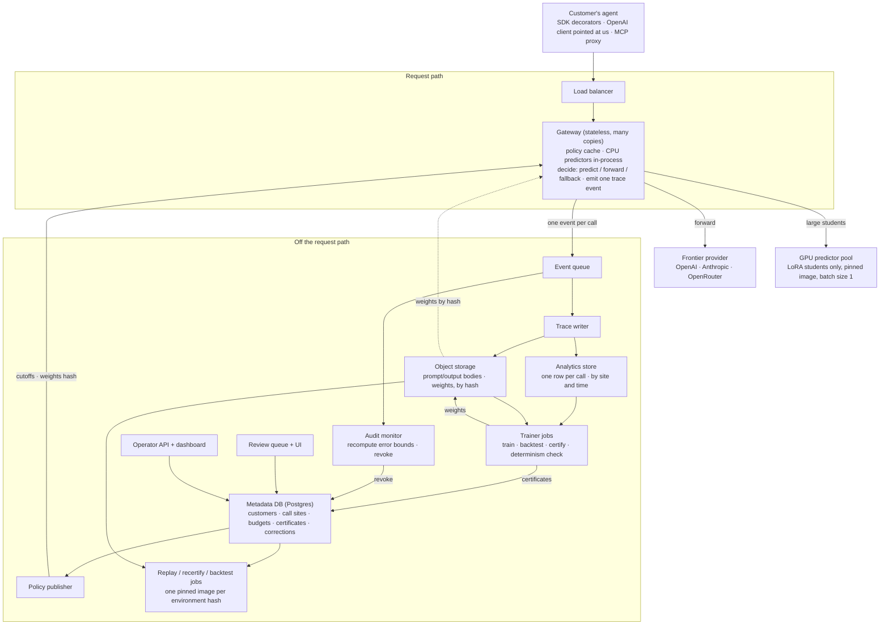
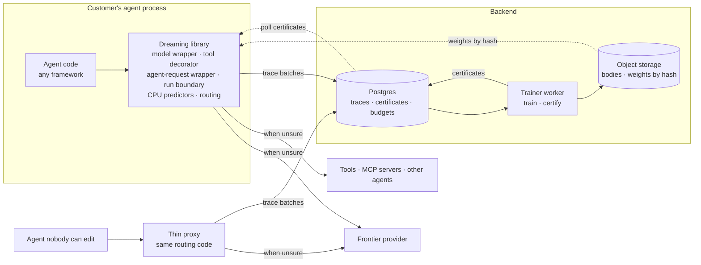
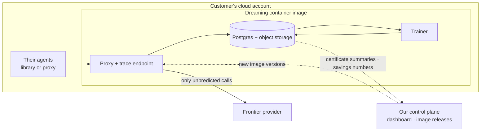
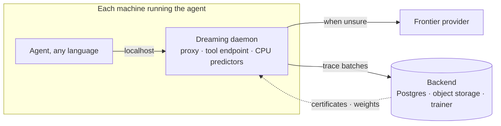
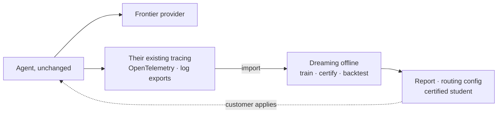
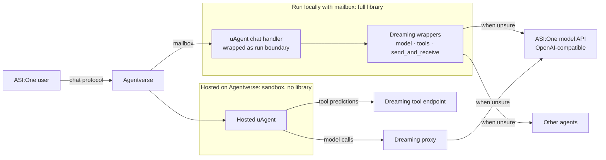

# Dreaming — System Design (full-scale, minimal)

Five ways to place the system, plus how the uAgents / ASI:One connector fits. They differ on three questions: **where the predict-or-call decision runs**, **where customer data lives**, and **how much backend storage is needed**.

## A. Hosted gateway

Two halves: the **request path**, which sits inside every call the customer's agent makes, and **everything off the request path**, which trains, certifies, audits, and replays.

Rules the gateway must keep: fail open (any internal error becomes a plain forward), never wait on storage, add milliseconds not tens.

## B. Library in the agent's process (recommended core)

The decision runs inside the customer's process, wrapping the four places an agent already makes calls. The backend shrinks to Postgres, object storage, and a trainer. The proxy is a thin adapter for agents nobody can edit and runs the same routing code.

Add the queue, columnar store, and policy publisher from A only when Postgres struggles.

## C. Customer-hosted container

Same parts as B, shipped as one pinned container image that runs in the customer's cloud. Prompts never leave their account. The image digest doubles as the environment hash.

## D. Local daemon

A small process next to the agent on each machine. Language-agnostic like the proxy, almost no network hop like the library. The customer deploys and upgrades it everywhere the agent runs.

## E. Offline advisor

Nothing in the live path. Dreaming imports traces the customer already collects, then hands back a report, a routing config, or a certified student for them to deploy. No tool interception, no live replay.

## Connector: uAgents and ASI:One

uAgents is one more framework under B. An existing uAgent keeps its handlers and adds the wrappers. Agents run locally with a mailbox get the full library. Agents hosted on Agentverse run in a sandbox, so they use the proxy and a tool endpoint instead.

## Choosing

| Option | Decision runs | Prompts leave the customer | Customer effort | Tools and whole-run replay |
|---|---|---|---|---|
| A. Hosted gateway | Our servers | Yes | Change base URL | No |
| B. Library | Their process | Traces only, unless self-hosted | Code change | Yes |
| C. Customer-hosted | Their cloud | No | Run our image | Yes, with the library |
| D. Local daemon | Their machines | Traces only | Deploy a process | Tools yes, replay no |
| E. Offline advisor | Nowhere live | Trace export | Export logs | No |

Default: B as the core, the proxy as its thin adapter, and C as the deployment for privacy-sensitive clients.
