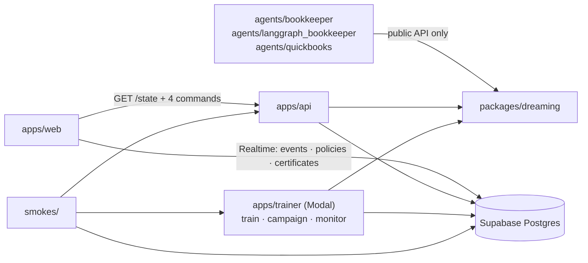

# Repo layout

Real code and contracts; stubs say `shortcut:` and raise. `missions.md`, `design.md` and `tracks.md` (the facts) stay at the real
repo root; the engineering docs are in `docs/` here.

## At a glance

| Folder | What lives there | Deployed? |
|---|---|---|
| `packages/dreaming/` | The library: contracts, router, gate, hashing, store, runtime, learning, predictors (the candidate slot), teachers (the provider table), connectors, replay, speculation | No, imported by everything else |
| `apps/` | Thin entry points: `api` (Fly), `trainer` (Modal: `train`, `embed`, the campaign and its monitor), `web` (static page served by the API) | Yes |
| `agents/` | Workflows written the way a customer would write them; they import only the library's public API: `bookkeeper` (demo), `langgraph_bookkeeper` (proxy path), `quickbooks` (benchmark) | Yes (`bookkeeper` on Fly) |
| `db/migrations/` | The schema of record: one column per contract field; `0002` adds candidates, the campaign tables and memory rows | Applied to Supabase Postgres |
| `docs/` | Tracks, training plan, speculation, sponsor devtools: one file each, index in `docs/README.md` | No |
| `experiments/` | Small runnable checks behind a doc's numbers (`speculation/sim.py`) | No |
| `infra/` | Fly config, serve image, service facts, keepalive | No |
| `smokes/` | End-to-end checks against the deployed services, and their results | No |

## How the folders depend on each other

## Root files

| File | Purpose |
|---|---|
| `README.md` | How to run, where to look |
| `DESIGN.md` | The system design: components, contracts, the slots, services, failure isolation, telemetry, build order |
| `.env.example` | Names of every secret, no values |
| `pyproject.toml` | uv workspace root; pyright strict and ruff config |
| `uv.lock` | Pinned versions |
| `justfile` | `check`, `dev`, `fast-forward`, `migrate`, `schema`, `record`, `replay`, `campaign`, `monitor`, `deploy-*`, `smoke` |

## `docs/`

| File | Purpose |
|---|---|
| `README.md` | Index, the sign-in checklist, what is decided and what is open |
| `tracks.md` | Per track: requirement → component → evidence → the sentence we can say → open |
| `training-plan.md` | Candidates, data (both workflows, the Intuit sites), the parallel campaign, the monitor and pruning rules, the numbers we defend, cost and time, the night's order |
| `speculation.md` | Running nodes in parallel on predicted values: what it buys (simulated), the lazy-future design, the verdict |
| `devtools.md` | How to use each sponsor's tool during development, the minimal real use, the evidence to keep, when to quit it |

## `packages/dreaming/src/dreaming/`

| Module | Purpose |
|---|---|
| `__init__.py` | Public API: `step`, `tool`, `effect`, `run_boundary`, `wrap_openai`, `Runtime` |
| `contracts.py` | Every object that crosses a boundary (Pydantic); exported as JSON Schema for the page. Adds `TrainRun`, `Checkpoint`, `EvalSet` for the campaign |
| `context.py` | Per-run state: run id, call counter, mode, virtual clock, seeded rng |
| `registry.py` | `@step` / `@tool` / `@effect` declarations → CallSites (with `candidates`); the dispatch seam |
| `router.py` | The one predict-or-call function and its decision table |
| `gate.py` | Fixed-grid Clopper-Pearson certificate. Pure math |
| `hashing.py` | Canonical JSON; prompt, weights and environment hashes |
| `store.py` | `Store` Protocol, `MemoryStore`, `PostgresStore` |
| `telemetry.py` | `emit` (Event + JSON log line), `boundary` (one `component.error` per failed seam); sinks: Logfire, Sentry |
| `runtime.py` | Native step runner: dispatch, runs, batches, metrics (lazy `Pending` results are planned with speculation, after the hackathon) |
| `learning.py` | The per-site state machine and the one place certificates are issued: one training job per candidate, spares shadow every call into `TraceRow.shadow`, each certified at δ/N on the same calibration rows, the best coverage answers (`Policy.candidate`, `Policy.shadow`); a revoked winner hands over to a spare on the audited rows or the site re-certifies in testing; audits, outages |
| `replay.py` | `replay` (re-execute a run's predicted rows byte for byte), `recertify`, `backtest` |
| `speculate.py` | `Pending` (guess, verified, result) and the guess-and-verify rule (`docs/speculation.md`); a stub today |
| `predictors/` | `Predictor` Protocol, `Loader` (dispatches by candidate), `candidates.py` (the registry: `head`, `exact`, `config` built; `memory`, `online`, `hdc`, `finetune` to port), `student.py`, `tool.py`, `router.py`, `train.py` (`Trainer`, `LocalTrainer` calling `CANDIDATES[req.candidate].fit`; `fit_head_from_rows`) |
| `teachers/` | `Teacher` Protocol, prompt rendering, label parsing; `openai_compat.py` (the `PROVIDERS` table: OpenRouter pinned, ASI:One, StepFun, Gemini; one client per provider, dispatched per call site), `recorded.py` (fast-forward) |
| `connectors/` | `openai_client.py` (wrap in place), `proxy.py` (HTTP), `uagents.py`, `mcp.py` |
| `../tests/` | `conftest.py` fakes; gate, hashing, store, the whole loop offline, and `test_candidates.py`: two candidates, promotion at δ/N, revocation and handover without retraining |

## `apps/`

| App | Files | Runs on |
|---|---|---|
| `api/` | `main.py` (routes; `/v1/systemone` and `/campaign/*` are planned, DESIGN §12 step 3), `wiring.py` (env → Runtime, the only place that picks implementations), `trainer.py` (Modal caller) | Fly, CPU |
| `trainer/` | `modal_app.py` (image, `train`, `embed`), `campaign.py` (a deployable app: `prepare_site`, `train_cell`, `train_cell_gpu`, a cron `monitor`, a `launch` entrypoint; bodies raise, step 2), `monitor.py` (`table`, `prune` contract, step 2) | Modal |
| `web/` | `index.html` + `app.js` (developer view driving every route), `live.js` (Realtime + polling fallback), `schema.json`/`schema.d.ts` (generated), `README.md` (the page's contract) | served by the API |

## `agents/`

| Agent | Files |
|---|---|
| `bookkeeper/` | `workflow.py` (four call sites), `tools.py` (mock world), `offline.py` (rule teacher, hashed encoder), `agent.py` (uAgent: relays chats to the API), `fast_forward.py`, `record.py` |
| `langgraph_bookkeeper/` | `graph.py` (same task through the proxy, mission 6) |
| `quickbooks/` | planned (DESIGN §12 step 3): `data.py` (Intuit's YAML → rows and eval sets, held out by company; runs inside `prepare_site`), `workflow.py` (`invoice_paid`, `bill_account`, `bank_match`), `baselines.py` (the customer and vendor rules, the exact cache, the LLM, Jev) |

## Everything else

| Path | Purpose |
|---|---|
| `db/migrations/0001_init.sql`, `0002_campaign.sql` | Tables, indexes, RLS for the browser role, Realtime publication. Idempotent |
| `infra/fly.toml`, `infra/serve.Dockerfile` | API + agent on one Fly app |
| `data/` | `recorded.jsonl` and `embeddings.npz` from `just record` (not yet recorded: needs a teacher key with quota); shipped in the image |
| `experiments/speculation/sim.py` | The latency simulation behind `docs/speculation.md` |
| `infra/SERVICES.md` | Facts, prices, gotchas per service, with sources |
| `infra/supabase-keepalive.yml` | Cron ping so the free project never pauses |
| `smokes/` | `smoke_supabase.py`, `smoke_modal.py`, `smoke_api.py`, `smoke_asi.py`, `smoke_agent.py`, `modal_db.py`; `RESULTS.md` |
