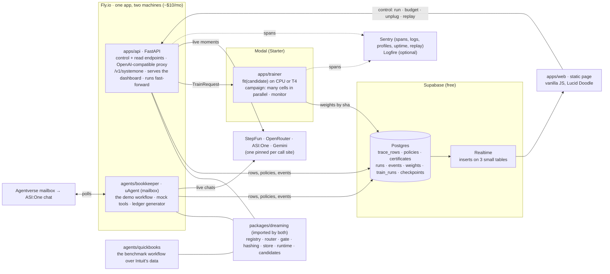

# Dreaming demo: system design

What runs where, which external service does which job, and the contracts that hold it together. Product spec: `../missions.md`.
Deployment options: `../design.md` (this is option B, the library in the agent's process, with a thin API and jobs offloaded).
Repo layout: `TREE.md`. Measured facts: `smokes/RESULTS.md` and `../smokes/FINDINGS.md`. Tracks, training, speculation and
sponsor devtools: `docs/`.

## 1. In one paragraph

An agent workflow runs as ordinary Python with decorated call sites. The **library** (`packages/dreaming`) logs every call as one
trace row, keeps one policy per call site, and advances each site through awake → watching → testing → dreaming. For every site it
trains **every registered candidate predictor in parallel**, keeps them all in shadow, certifies each one on shadow rows it never
trained on, and promotes the one with the most certified coverage at the operator's error budget; the others stay as hot spares.
**Postgres on Supabase** is the single source of truth; the **dashboard** is a static page that reads it through Supabase Realtime.
Training is a **job** (Modal by default; the same pure function runs locally or on veri.studio). Certification is never a job: it is
the gate over stored shadow rows, which is why dragging the budget slider re-certifies every site in milliseconds. The **API** and
the **uAgent** are two small always-on processes on **Fly.io**. The pinned frontier teacher is whichever OpenAI-compatible provider
the call site names (StepFun `step-5-preview` for the demo, OpenRouter and ASI:One as alternatives); in fast-forward mode teacher
answers come from a pre-recorded file and are labelled as such. Two workflows run on the same library: the **bookkeeper** (the live
demo) and the **QuickBooks** workflow over Intuit's 100-company dataset (the benchmark).

## 2. The shape

## 3. Components, one job each

| Component | Job | Must not do | Fails how |
|---|---|---|---|
| `packages/dreaming` | log, route, gate, hash, replay, train candidates. Pure functions over the contracts. | network, I/O other than through `Store`, `Teacher`, `Trainer` | never: a predictor or store error is a miss and one `component.error` event |
| `apps/api` | control plane for the dashboard; OpenAI-compatible proxy and `/v1/systemone` for outside callers; runs fast-forward | train, own state (everything is in Postgres) | dashboard buttons fail; Realtime keeps showing state |
| `apps/trainer` | `TrainRequest` (exactly the rows and the candidate it names) → weights by sha; the offline campaign and its monitor | certify, touch policies | `train.failed` event; the site stays awake; `TRAINER=local` trains in-process |
| `agents/bookkeeper` | the demo workflow as a customer would write it; the uAgent relays ASI:One chats to the API | hold policies or a store of its own | ASI:One chats fail; the dashboard demo continues |
| `agents/quickbooks` | the benchmark workflow: Intuit's companies as customers, held out by company | anything the bookkeeper does not do | the benchmark table is missing a row |
| `apps/web` | show state, send four commands | compute anything | page says which dependency is red (`/healthz`) |
| Postgres | truth | | everything stops; this is the one accepted single point of failure |

## 4. The contracts

`packages/dreaming/src/dreaming/contracts.py` is the whole vocabulary; `db/migrations/*.sql` mirrors it column for column;
`just schema` exports it as JSON Schema and a `.d.ts` for the page. Four objects carry the system:

- **CallSite** (static, from `@step` / `@tool` / `@effect` in `registry.py`): labels, descriptions, pinned teacher, fallback,
  thresholds, and `candidates`: the names of the predictor families to train for it.
- **TraceRow** (one per call): request and its sha, response, `decision` (called · predicted · audited · fallback), the
  `Prediction` that answered (with its three hashes and its `candidate`), every other candidate's shadow prediction in
  `shadow`, the `TeacherAnswer` with provider and cost, `agree`.
- **Certificate**: above `cutoff`, wrong at most `budget` with probability 1−δ, on exactly the rows `calib_sha` names, for one
  `candidate` under one `weights_sha`, `env_sha` and `teacher_sha`.
- **Event**: `component` + `kind` + `message` (+ `error`): the dashboard's narration and the audit trail.

`Policy` is the per-site state the router reads (phase, the promoted candidate's cutoff, cert and weights, counts, outage, and
`shadow`: each other candidate's latest weights, certificate and coverage). The router's decision table is the docstring of
`router.py`; the state machine is the docstring of `learning.py`. The two campaign objects (`TrainRun`, `Checkpoint`) are in
`docs/training-plan.md`.

Rules that make the loop honest (from the smokes and the critic's pass):
- **Calibration rows are shadow rows the weights never trained on, collected before promotion.** Every trace row records the
  site's phase at call time; only `watching`/`testing` rows calibrate. The gate runs at checkpoints (every `calibrate_after` rows)
  and on a budget change, never on every tick (S18).
- **Selection and certification never share a bound.** With N candidates on one calibration slice each is certified at δ/N
  (the grid certifier already spends δ/40 per coverage level); the winner is the one with the most certified coverage.
- **Audits are the standing check.** After promotion 1 in 20 confident answers still goes to the teacher; when the audit bound
  exceeds the budget the certificate is revoked. A spare is promoted in its place only if the spare's own shadow predictions on
  those audited rows (unbiased, stored in `TraceRow.shadow`) pass the gate at the budget; the spare's old certificate came from the
  same calibration slice the traffic just drifted away from, so it is not evidence on its own. Otherwise the site goes to testing.
- **A certificate names candidate, weights, environment and teacher**; if any differs at startup the site goes back to testing.
  Replay loads the exact weights a row names, re-runs the forward pass with every cache bypassed, and never re-executes a router row.
- **Outages are detected, never declared.** Three consecutive failures of the real call set `Policy.outage`; one call in twenty
  keeps probing; a success clears it. Only tools are short-circuited while down; a model step always calls its teacher.
- **Fixed-grid Clopper-Pearson** (`gate.py`). Confidence is quantized to 4 decimals before it is thresholded or hashed (S7).
- **Provider pinned and logged in every row** (S13). The error budget is disagreement with that reference; budgets below the
  teacher's own self-disagreement (1–11% by model) are unmeasurable and the page refuses them.
- **Tools: reality is the teacher.** The calibration set includes novel inputs at the deployment's rate (S4).
- **Byte-identical means (label, quantized confidence) under the same weights and env hashes** (determinism.md).

## 5. The slots: what can change, and how it slots in

We do not know which predictor, which teacher, or which training platform wins. Each is behind one Protocol with one registry,
so the winner is a table entry, not a refactor. Everything else (gate, router, store, replay, page) reads only the contracts.

| Slot | Protocol (file) | Registry / selector | What a new entry needs | Today |
|---|---|---|---|---|
| **Candidate predictor** | `Predictor.predict(rendered) -> Prediction`; `Candidate.fit(site, rows, encoder) -> Fitted` (bytes + n_train, holdout accuracy, seconds); `Candidate.load(site, bytes, encoder) -> Predictor` (`predictors/candidates.py`) | `predictors.CANDIDATES: dict[name, Candidate]`; `CallSite.candidates` (the `candidates=` argument of `@step` / `@tool`) lists which to train, default by kind; `TrainRequest.candidate` / `TrainResult.candidate` carry the name through the trainers and `Loader.load` | one module, two functions; `needs_gpu` and `needs_encoder` flags; byte-stable `(label, confidence)` at batch 1; **a live site's candidates must share its encoder** (a second encoder is a full forward pass per call, ~300 ms on Fly's shared CPU): `finetune` and `head@base` run in the campaign, and if one wins a site that site's encoder is swapped at deploy and its rows re-embedded | `head` (frozen encoder + linear head), `exact` (tool memory), `config` (router): built and wired end to end, one candidate per site; the parallel loop is step 1 of §12; `memory` (Hopfield), `online`, `hdc`, `finetune` are ports from the smokes (`docs/training-plan.md` §1) |
| **Teacher** | `Teacher.ask(site, rendered) -> TeacherAnswer` (`teachers/__init__.py`) | `TeacherSpec.provider` → `teachers.PROVIDERS[name] = Provider(base_url, key env var, max_tokens for a label)`; one `OpenAICompatTeacher` holds a client per provider and dispatches per call, so two sites in one process can pin two providers; `wiring.py` gives it every key that is set | one table row for an OpenAI-compatible API; a class for anything else | rows: `openrouter` (pinned Anthropic), `asi1`, `stepfun` (`max_tokens` 256: reasoning cannot be off), `gemini`; `rule` (offline) and `recorded` are separate classes; `TEACHER=openrouter | asi1 | stepfun` picks which spec the bookkeeper workflow pins (`workflow._teachers`); `TeacherSpec.floor` holds the measured self-disagreement |
| **Encoder** | `Encoder.embed(text) -> vec`, `model_sha`, `env_sha` (`predictors/student.py`) | `ENCODER` env var; every candidate records `encoder_sha`; a swap invalidates that site's rows and certificates | a hub id + revision, or a local dir; batch 1, pinned threads | bge-small `5c38ec7c` (33M); bge-base optional (+0.14 coverage at k=3, 3× slower) |
| **Trainer** | `Trainer.train(req, site, rows) -> TrainResult` (`predictors/train.py`) | `TRAINER` env var; the job is always `CANDIDATES[req.candidate].fit(site, rows, encoder)` | a way to ship the rows somewhere, run the candidate's `fit`, and get bytes back by sha | `local`, `modal`; **`veri`** (`veri run-script` running the S8 v2 recipe standalone on their Python 3.10 image, same artifact format, weights downloaded) is the sponsor row, see `docs/devtools.md` |
| **Workflow** | `@step` / `@tool` / `@effect` + a run function; or a connector (proxy, OpenAI client wrapper, MCP, uAgents) | the registry; one `Runtime` per process | call sites with labels and descriptions; a fallback per tool | `bookkeeper` (demo), `langgraph_bookkeeper` (proxy path), **`quickbooks`** (benchmark, `docs/training-plan.md` §2) |
| **Store** | `Store` Protocol (`store.py`) | `DATABASE_URL` | the same tables | `MemoryStore`, `PostgresStore` (Supabase); Tiger Data would be the same Postgres driver |
| **Telemetry sink** | `telemetry.emit`, `telemetry.boundary` | env vars, one per sink | a sink that takes an `Event` and a span | stdout JSON (always), `events` table (always), Logfire (`LOGFIRE_TOKEN`); **Sentry** (`SENTRY_DSN`: FastAPI and httpx integrations switch on by themselves, no psycopg integration exists, AI-agent spans by hand from `run_boundary` and `router.route`, Logs from the JSON lines; to add) |
| **Serving format** | `/v1/chat/completions` (proxy), `/v1/systemone` (state + typed questions → probabilities) | both routes call `router.route` | nothing: a `Prediction.scores` already is a probability per allowed answer | proxy built; **`/v1/systemone` is one route** that maps questions to call sites (Intuit's preferred API, `docs/tracks.md`) |

Two rules keep the slots clean: (1) implementations are picked in `apps/api/wiring.py` and nowhere else; a slot entry may read
execution facts (`ENCODER_REV`, thread counts, the image id) into its env hash but never chooses an implementation from the
environment; (2) a slot entry never writes a `Policy` or a `Certificate`; only `learning.py` does.

How the candidate loop runs per site (`learning.py`): at `watch_after` rows, one `TrainRequest` per candidate in `site.candidates`
(CPU candidates in the learner's thread pool, GPU candidates as Modal jobs that land on a later tick); every candidate predicts
in shadow on every call (one embedding shared, each head microseconds; the row's `shadow` carries every candidate's label and
confidence); at each checkpoint every candidate is certified at δ/N and the best coverage is promoted; a revocation promotes the
next-best certified candidate; the budget slider re-gates all of them.

## 6. The demo moments, as data flow

| Moment | What happens | Where | Time |
|---|---|---|---|
| **run 2,000** | `Runtime.fast_forward`: each transaction runs the four steps; teacher answers come from `RecordedTeacher` (misses go live and are counted), tools from the in-process mock env with a virtual clock; rows and runs are batched to Postgres every 200; every 20 runs `tick()` advances sites and emits `batch.progress` with `Metrics` | API process | measured on Fly shared-cpu-1x: 9 runs/s while sites are awake, ~1 run/s once they dream because every predicted call embeds on the shared CPU (~300 ms); the embedding cache from `just record` or a second core fixes it |
| categorize learns | at 60 rows the learner submits one `TrainRequest` per candidate; weights come back by sha; site → watching; at 500 calibration rows → testing → certificates per candidate → the best is promoted → dreaming | API → Modal (or local) → Postgres | head 1–3 s warm; memory 0 s; a cold Modal start pauses the batch for its duration |
| **budget slider** | `POST /budget` → gate over stored shadow rows per site and candidate → new certificates or revocations, possibly a different winner | API, pure math | ms |
| **unplug the API** | `POST /tools/vendor_lookup/outage` flips the mock's fault switch; the runtime detects the outage; certified inputs are answered by the promoted predictor, the rest by the registered snapshot | API | within a few calls |
| **replay this run** | `POST /replay/{run_id}`: predicted rows re-execute on the logged prompt with the same weights; everything else is read from the log; `same_bytes` per row | API | ~10 ms per row (3.9 s for a run on Fly today, encoder on the shared CPU) |
| **ASI:One chat** | user → Agentverse mailbox → uAgent → `POST /run` on the API → a live run → reply with which calls were predicted and under which certificate | agent → API | 20–40 s round trip (S11) |
| **the benchmark table** | `agents/quickbooks` over held-out companies, one row per provider and per candidate: coverage at the budget, realized error, cost and latency with and without Dreaming | campaign on Modal → `train_runs` / `checkpoints` → `docs/training-plan.md` §5 | hours, offline, before the demo |

The dashboard needs only `GET /state` on load, Realtime on `events`, `policies` and `certificates`, and the four commands.
`GET /events?after=` is the polling fallback.

## 7. Failure isolation

Every component writes `Event`s with `component`, `kind`, `error`; the API stamps every event emitted while handling a request
with the request's trace id; `/healthz` probes the database and reports what else is configured.

| Breaks | The judge sees | Root cause field | Degraded mode |
|---|---|---|---|
| Modal unreachable | "training for categorize failed"; site stays awake | `train.failed`, `data.dependency = trainer` | restart with `TRAINER=local` |
| the pinned teacher is down or out of credit | fast-forward unaffected (recorded); live chat and audit calls fail | `component.error` / `teacher` | audit sample skipped, logged as such; `TEACHER=` another provider is a redeploy, and sends every site back through the gate (the certificate names the teacher) |
| Supabase Realtime down | page stops updating; buttons still work | `/healthz` → `realtime` | page polls `GET /events?after=` every 2 s |
| Postgres down | everything stops | `/healthz` → `db` | none; accepted |
| uAgent down | ASI:One chat times out | `agent.heartbeat` event stops | dashboard demo continues; a laptop runs the agent with the same seed |
| Sentry or Logfire down | nothing: sinks fail open | | stdout JSON and the `events` table remain |

## 8. Telemetry

- `telemetry.emit()` writes one `Event` and one JSON log line per thing worth seeing (phase changes, certificates, jobs, outages,
  errors). Trace rows are data, not events: written in batches, never streamed.
- `telemetry.boundary(dep)` wraps every call into another component; a failure becomes one `component.error` naming the dependency.
- Sinks: stdout JSON (Fly and Modal keep them); `LOGFIRE_TOKEN` → Logfire; `SENTRY_DSN` → Sentry (`sentry-sdk==2.72.0`): the
  FastAPI and httpx integrations switch on by themselves (there is no psycopg integration; db spans are hand-made or skipped),
  every run as a `gen_ai.invoke_agent` span and every `router.route` as a `gen_ai.execute_tool` or `gen_ai.chat` span carrying
  `dreaming.decision`, `dreaming.candidate`, `dreaming.cert_id`; Sentry Logs for the JSON lines; an uptime check on `/healthz`
  and Session Replay on the page as extras (profiling is not on the free plan). Spans are sampled (`SENTRY_TRACES=0.05` for
  batches); Postgres stays the system of record.
- `/healthz` returns `Health {checks: {db, trainer, teacher, realtime}}`.

## 9. Types and tests

- Python: pyright **strict** on the library, apps and agents; Pydantic v2 at every boundary. Optional heavy extras import lazily.
- Browser: `// @ts-check` + JSDoc types from `apps/web/schema.d.ts`, generated from `contracts.py`.
- Tests, four layers: unit (gate, hashing, router table, each candidate's byte-stability); the whole loop offline in under a
  second with fakes, with two candidates and a revocation that fails over; `PostgresStore` against a local Postgres; `smokes/`
  against the deployed services.

## 10. External services: decisions

| Need | Choice | Why | Cost | Human sign-in |
|---|---|---|---|---|
| Database + live feed + small weights | **Supabase** (free) | browser subscribes to inserts with the publishable key; plain SQL migrations; RLS keeps anon read-only | $0; 500 MB, 100 msg/s | done (project `dreaming`); keep-alive ping every 3 days |
| Training, embedding, the campaign | **Modal** (the campaign as its own app `dreaming-campaign`) | `Function.spawn` fans out (8 concurrent cold starts finished in 21 s on the Starter account, measured 2026-10-17); Starter: 100 containers, 10 concurrent GPUs; pinned image; T4 ($0.59/h) for fine-tunes; Volume for artifacts; cells connect to Postgres only at checkpoints (session pooler, 12 CPU containers) | $30/mo credit once a card is on file ($1 before); tonight's matrix is est. under $1 | add a payment method |
| Always-on API + agent | **Fly.io** | one app, two process groups | ≈ $10/mo | done |
| Frontier teacher, pinned per site | **StepFun `step-5-preview`** for the demo workflow (the sponsor requires the running workflow to call it), `reasoning_effort="low"`, `temperature=0`; the router site's cheap configuration is the `step-3.5-flash` tier (thinking cannot be switched off on StepFun); OpenRouter (Anthropic pin) and ASI:One as benchmark rows and fallbacks | one provider per certificate (S13) | $1.00 in / $2.70 out per M (reasoning billed as output); voucher accounts: 5 concurrent, 100 RPM, so a 2,000-run record is ≈ 1 h per seed; StepFun voucher $25; OpenRouter needs a top-up | StepFun key from the Starter Pack; OpenRouter top-up |
| Sponsor front door | **ASI:One** + **Agentverse** mailbox | S11: scriptable after keys exist | ASI:One key has a request quota | done; quota |
| Observability | **Sentry** `sentry-sdk==2.72.0` (the two products beyond errors: Tracing and Logs, plus AI-agent spans; uptime on `/healthz` and Replay on the page as extras; profiling is not on the free plan; there is no psycopg integration, so db spans are hand-made or skipped) and the `events` table; Logfire optional | the Sentry track judges how observability shaped the build: `docs/devtools.md` keeps the dated log of what it caught | free: 5M spans, 50 replays, 1 uptime monitor, 1 user | Sentry account, one DSN |
| Sponsor training platform | **veri.studio** `run-script` for one candidate on one site (the fine-tuned encoder, a standalone `train.py` on their Python 3.10 / torch 2.8 image), weights downloaded, hashed and certified here; fallback: one managed SFT job on Qwen3-0.6B over one site's rows | the track requires the training to happen there | L4 $1.05/h; credits from their rep (redeem before the first job) | redeem credits, `veri login` |
| Benchmark runner | **CREAO** agent that synthesizes seed rows with CREAO's model, then calls our `POST /campaign/run` and `GET /campaign/{id}` to train and evaluate one provider row | counted as core use by their team; judged 30% on "remove the agent and it stops working" | hackathon plan (Pro Plus for the weekend) | CREAO account via the hackathon link, `capi_` key, Secrets with our API key |
| Dashboard hosting | served by the API | zero extra service | $0 | none |

Not chosen, and why: RunPod for the campaign (10-min boots; fine as a backup for GPU cells); Neon, Railway, Render; Modal for the
agent (24 h cap); LiteLLM/Helicone/Langfuse as the proxy; Temporal/queues; Next.js; a GPU predictor pool. Tiger Data and Solana
stay optional (an audit copy of each certificate's calibration rows; a memo of each certificate's hash).

## 11. Verified live, and what is still open

Verified with keys on 2026-10-17 (`smokes/RESULTS.md`): Supabase project with the schema applied from Modal, Realtime
publication and RLS; the Modal trainer deployed, `embed` byte-equal across calls (cold 21.7 s, warm 0.6 s), 8 concurrent spawns
done in 21 s; ASI:One answering; the API and the agent on Fly (`https://dreaming-demo.fly.dev`), the agent registering its own
mailbox; a 2,000-run batch on the deployed stack **with the offline rule teacher** (`TEACHER=rule`) in which all four sites
trained on Modal, certified at 5% and dreamed (categorize 40% coverage, vendor_lookup 67%, match_invoice 60%; the router site's
100% is by construction, its cheap configuration being the same rule teacher), replay byte-identical. Coverage against a frontier
teacher is pending the StepFun record pass. The Modal fan-out spike (8 concurrent `embed` spawns, all back in 21 s) is in
`smokes/RESULTS.md`; the 50-spawn check in `docs/devtools.md` §Modal runs before the matrix is launched.

Findings that change the ops story: the laptop's network blocks outbound 5432/6543 (the database is reached from Modal and Fly);
OpenRouter reserves the whole output window when `max_tokens` is unset (typed steps send 64); ASI:One has a total request quota;
Modal's credit is $1 until a card is added.

Still open: the StepFun key and its self-disagreement (the floor of every certificate it backs); the δ/N selection cost
(reasoned, unmeasured); the campaign's first smoke; whether Sentry's Agents view fills from hand-made spans; whether a veri
`run-script` job's artifacts download (save in Hugging Face layout, test on a tiny job first); what Intuit means by a
"System-One-compatible API" (we serve TypeSafe's `/v1/systemone` wire format; confirm with the mentor).

Pinned in code on 2026-10-17 evening (`just check` green): `contracts.py` carries `CallSite.candidates`, `Prediction.candidate`,
`TraceRow.shadow` / `speculated` / `kept`, `Certificate.candidate`, `Policy.candidate` / `shadow` (`Spare`), `Run.critical_ms`,
`Thresholds.speculate_at`, `TeacherSpec.floor`, `TrainRequest.candidate` / `TrainResult.candidate`, and the campaign rows
`TrainRun`, `Checkpoint`, `EvalSet`; `predictors/candidates.py` registers `head`, `exact`, `config`, both trainers call
`CANDIDATES[req.candidate].fit` and `Loader.load` dispatches by candidate (one candidate per site runs end to end);
`teachers/openai_compat.py` has the `PROVIDERS` table with `stepfun` and `gemini` rows and dispatches per call site;
`db/migrations/0002_campaign.sql` adds the columns and the `train_runs`, `checkpoints`, `eval_sets`, `memory_rows` tables and
`smokes/modal_db.py` applies every migration; `apps/trainer/campaign.py` is a deployable Modal app whose bodies raise
(`prepare_site`, `train_cell`, `train_cell_gpu`, a cron `monitor`, a `launch` entrypoint); `just deploy-campaign` / `campaign` /
`monitor` exist. **The live schema does not have the 0002 columns yet: step 0 below runs before any redeploy**, because
`PostgresStore` inserts every contract field and would fail (fail-open, silently) against the old schema.

## 12. Build order

Done offline and live: contracts, gate, hashing, router, learner (one candidate), stores, API with four commands, `/run` and
the proxy, the bookkeeper world and rule teacher, the uAgent, `just record`, the Modal trainer, the developer page, the deploy.

Tonight, in order (the clock is in `docs/training-plan.md` §7):
0. **Migrate and redeploy**: `modal run smokes/modal_db.py` (applies 0002), then `just deploy-trainer` and `just deploy-api`.
1. **Candidate loop** in `learning.py`: done 2026-10-17 23:15: one `TrainRequest` per candidate in
   `candidates.for_site(site)`, shadow predictions for every loaded candidate into `TraceRow.shadow`, each certified at δ/N, the
   best coverage promoted, the spare rule of §4 (with its arithmetic: the grid gate needs ≈130 error-free audited rows at a 5%
   budget, so a revocation at the 59-audit minimum usually hands over through re-certification in testing, one checkpoint later);
   the two-candidate failover test. Still to port: `memory` as the second default candidate (a stash holds a first draft).
2. **Campaign and monitor** bodies (`campaign.py`: `prepare_site`, `train_cell`, `train_cell_gpu`, `monitor`; `monitor.py`:
   `table`, `prune`): `just deploy-campaign`, `just campaign night-1017 categorize 3` as the smoke, then the tier-1 matrix.
3. **QuickBooks**: `agents/quickbooks/data.py` (runs inside `prepare_site`), the three sites, the rule and exact-cache baselines;
   `/v1/systemone` and `/campaign/*` routes in `apps/api` (the CREAO agent and the Jev check need them).
4. **StepFun as the pinned teacher**: `TEACHER=stepfun`, a 10-call parse check, 200 calls for `TeacherSpec.floor`, `just record 2000`
   for seed 0, flip `TEACHER` in `infra/fly.toml`, redeploy, re-prepare the bookkeeper sites with those labels.
5. **Sponsor evidence**: the veri cell, the CREAO benchmark agent, Devin on `hdc`, the Sentry sink and its caught-log, Paper frames.
6. Rewire `demo/index.html` to `/state`, Realtime and the four commands, with the candidate rows per site, if time remains.

After the hackathon: speculation (`docs/speculation.md`), `online` and `head@base` candidates, Tiger Data, Solana, Browser Use.
