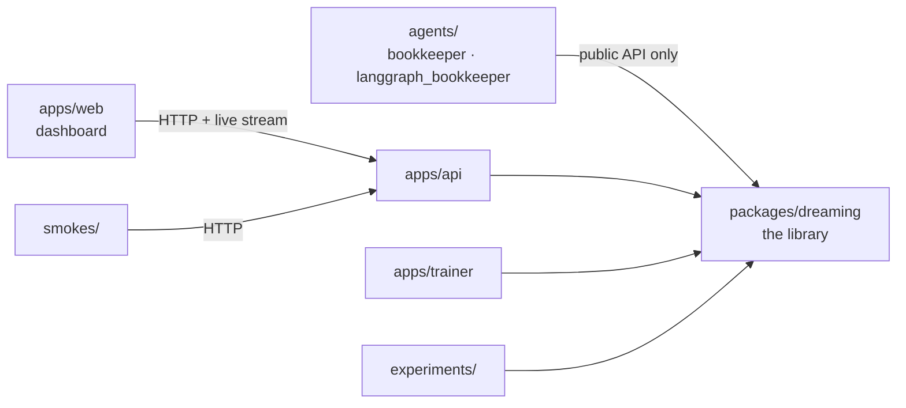

# Proposed repo layout (mock)

Every file in this folder is an empty placeholder. `missions.md` and `design.md` already live at the real repo root, so they are not duplicated here.

## At a glance

| Folder | What lives there | Deployed? |
|---|---|---|
| `packages/dreaming/` | The library. All real logic. Everything a customer would import. | No, imported by everything else |
| `apps/` | Thin entry points that get deployed: API, trainer, dashboard | Yes |
| `agents/` | Demo agents, written the way a customer would write them | Yes |
| `db/` | Database schema | Applied to Postgres |
| `infra/` | Docker images and deploy configs | No |
| `experiments/` | One folder per mission measurement | No |
| `smokes/` | End-to-end checks against the deployed services | No |

## How the folders depend on each other

## Root files

| File | Purpose |
|---|---|
| `README.md` | How to set up, run, and deploy |
| `.env.example` | Names of every secret, no values |
| `pyproject.toml` | uv workspace root. Members are `packages/*`, `apps/*`, `agents/*` |
| `uv.lock` | Pinned Python dependency versions, generated by uv |
| `justfile` | Short commands: dev, test, deploy, fast-forward, replay |

## `packages/dreaming/`: the library

| Path | Purpose |
|---|---|
| `__init__.py` | Public API: `step`, `tool`, `run`, `wrap`, `ask` |
| `context.py` | Per-run state: run id, clock, random generator, prefetch table |
| `registry.py` | Step and tool declarations |
| `router.py` | The one predict-or-call function |
| `gate.py` | Cutoff and error bound. Pure math, no I/O |
| `hashing.py` | Canonical JSON, plus prompt, weights, and environment hashes |
| `store.py` | Postgres and object storage access |
| `speculate.py` | Prefetching the likely next call |
| `replay.py` | Replay, recertify, backtest |
| `runtime.py` | Native step runner and fast-forward mode |
| `predictors/` | Encoder, linear head, tier router, tool returns, review head |
| `teachers/` | OpenRouter client, free-text judge |
| `connectors/` | OpenAI client wrapper, uAgents, MCP, LangGraph, Temporal |
| `tests/` | Unit tests for the library |

All module paths above sit under `packages/dreaming/src/dreaming/`, except `tests/`, which sits directly under `packages/dreaming/`.

## `apps/`: things that get deployed

| App | Purpose | Runs on |
|---|---|---|
| `api/` | FastAPI: model proxy, tool endpoint, dashboard API, live event stream | Fly machine, CPU |
| `trainer/` | Embeds rows, fits predictors, writes weights | RunPod GPU pod |
| `web/` | Next.js dashboard | Vercel or the same Fly app |

## `agents/`: demo agents

These import only the library's public API, the way an outside developer would.

| Agent | Purpose | Runs on |
|---|---|---|
| `bookkeeper/` | The main demo. A uAgent with a mailbox, reachable from ASI:One. Holds the workflow, mock tools, and data generator | Fly machine, CPU |
| `langgraph_bookkeeper/` | The same task built on LangGraph, to show mission 6 | Fly machine, CPU |

## Everything else

| Path | Purpose |
|---|---|
| `db/migrations/` | Numbered SQL files that build the schema |
| `infra/serve.Dockerfile` | Image for the API and agents. CPU only, no torch, starts fast |
| `infra/train.Dockerfile` | Image for the trainer. Torch and CUDA |
| `infra/fly/` | Deploy configs for the API and agents |
| `infra/runpod/` | Pod template for the trainer |
| `experiments/` | Scripts and result tables, one folder per mission |
| `smokes/` | End-to-end checks against the deployed services |
